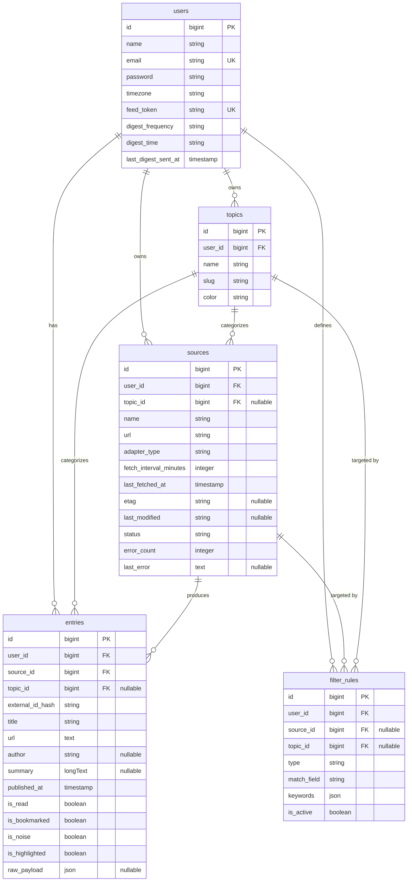

# Architecture & 6-Phase Implementation Plan — Signal-to-Noise Hub

> [Русская версия](../ru/ARCHITECTURE_AND_PLAN.md) · [Project Guide](README.md) · [Step-by-Step Laravel Tutorial & Build History](TUTORIAL_AND_BUILD_HISTORY.md)

This document captures the system architecture, key Architecture Decision Records (ADRs), database schema, and the 6-phase implementation roadmap.

---

## 1. Zero-Extra-Infrastructure Stack

All server mechanics rely strictly on **Laravel 13** built-in capabilities and standard PHP extensions — without Redis, Meilisearch, Docker microservices, or heavy third-party parsers:

| Concern | Implementation |
| :--- | :--- |
| **Database, Queue & Cache** | `SQLite` (WAL mode) + `QUEUE_CONNECTION=database` + `CACHE_STORE=database` |
| **Data Ingestion (Adapters)** | `Illuminate\Support\Facades\Http` + native PHP `SimpleXMLElement` (RSS 2.0, Atom, GitHub Releases, Reddit) + `json_decode` (JSON Feed 1.1) |
| **HTML Sanitization** | Native PHP `DOMDocument` (`App\Services\HtmlSanitizer`) |
| **Rate Limiting & HTTP Caching** | Per-host `RateLimiter::attempt()` + conditional headers `If-None-Match` (`ETag`) and `If-Modified-Since` (`Last-Modified`) |
| **Full-Text Search** | `laravel/scout` with `SCOUT_DRIVER=database` |
| **Private RSS Output** | `PrivateFeedController` + Blade RSS 2.0 XML view (`Content-Type: application/rss+xml`) + `Cache::remember` |
| **Frontend** | Blade components + Livewire 4 + Alpine.js 3 + Tailwind CSS |

---

## 2. Architecture Decision Records (ADRs)

### ADR-01: SQLite Concurrency with Queue Workers
- **Problem:** Under `QUEUE_CONNECTION=database`, concurrent writes from background queue workers and web requests can trigger `database is locked`.
- **Decision:** Enabled `'journal_mode' => 'wal'` and `'busy_timeout' => 5000` in `config/database.php` for the `sqlite` connection so readers never block writers and writers wait up to 5 seconds before failing.

### ADR-02: Composite Deduplication Key
- **Problem:** Some RSS feeds omit `<guid>` or mutate it upon article edits while keeping `<link>` or `<title>` constant.
- **Decision:** Compute `external_id_hash = hash('sha256', $source->id . ':' . $externalId)` where `$externalId` falls back gracefully (`guid ?: link ?: title`), enforced by a composite unique index `UNIQUE(user_id, external_id_hash)` in `entries`.

### ADR-03: Conditional HTTP Requests (`ETag` + `Last-Modified`) and `User-Agent`
- **Problem:** GitHub and Reddit reject generic/missing `User-Agent` headers and rate-limit redundant polling.
- **Decision:** Persist both `etag` and `last_modified` on `sources`, send `User-Agent`, `If-None-Match`, and `If-Modified-Since`, and short-circuit on `304 Not Modified` without parsing XML/JSON.

### ADR-04: Deterministic Rule Engine Precedence (`Include → Exclude → Highlight`)
- **Decision:**
  1. If one or more active `include` rules match the entry's scope (global, source, or topic), the entry remains signal only if at least one `include` rule matches; otherwise `is_noise = true`.
  2. Next, active `exclude` rules are evaluated; any match sets `is_noise = true`.
  3. Only when `is_noise === false` are `highlight` rules checked; any match sets `is_highlighted = true`.

---

## 3. Database Schema

---

## 4. 6-Phase Implementation Plan & Division of Responsibilities

The project followed a paired mentorship workflow: **Developer (Laravel backend core & architecture)** + **Antigravity (Tailwind/Alpine UI, HTML XSS sanitization, factories/seeders, and automated test suites)**.

- **Phase 1 — Foundation, Database Schema & Source CRUD:** Laravel 13 + Livewire 4 bootstrap, SQLite WAL configuration, 5 core tables and Eloquent models, Form Requests, `TopicManager`, `SourceManager`, authentication, factories, and `DatabaseSeeder`.
- **Phase 2 — Adapter Layer & Manual Ingestion:** `EntryData` DTO, `SourceAdapterInterface`, `AdapterFactory`, `RssAtomAdapter`, `JsonFeedAdapter`, `EntryIngestionService`, `sources:fetch` command, `HtmlSanitizer`, and fixture-based unit/feature tests.
- **Phase 3 — Queues, Scheduler & Rate Limiting:** `FetchSourceJob` (`$tries = 3`, `$backoff`), per-domain `RateLimiter`, `ETag`/`Last-Modified`/`304`, minutely `Schedule`, UI `Fetch Now` button & health indicators, and queue/HTTP fake tests.
- **Phase 4 — Signal-to-Noise Engine:** `NoiseFilterService` integrated into `EntryIngestionService`, `SaveFilterRuleRequest`, `FilterRuleManager` with in-memory rule preview, Alpine.js chip builder UI, and unit/feature tests.
- **Phase 5 — Web Feed Hub & Full-Text Search:** `laravel/scout` (`database` driver), `FeedHub` component with URL-synced tabs/filters and actions, slide-over reading drawer, Alpine.js keyboard shortcuts, and Scout search tests.
- **Phase 6 — Output Channels (Private RSS & Email Digests):** `PrivateFeedController`, RSS 2.0 XML template, `DailyDigestMail`, `SendDigestMailJob`, timezone-aware `digests:send` command, `ProfileSettings`, and tests using `Mail::fake()` and `Carbon::setTestNow()`.
