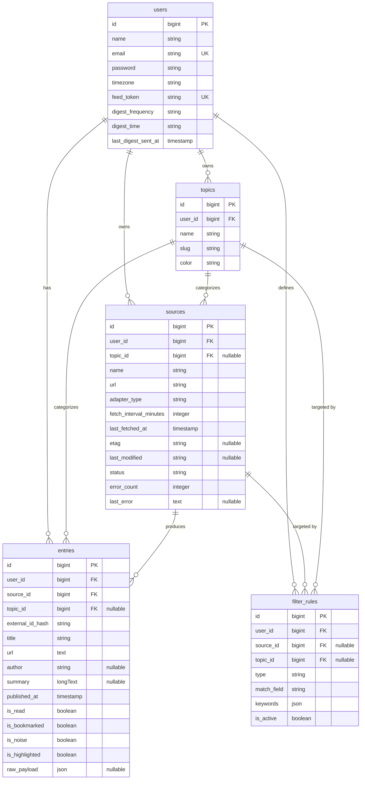

# Архитектура и пофазный план разработки Signal-to-Noise Hub

> [English version](../en/ARCHITECTURE_AND_PLAN.md) · [Руководство по проекту](README.md) · [Пошаговый учебник и история создания](TUTORIAL_AND_BUILD_HISTORY.md)

Этот документ фиксирует исходную концепцию проекта, ключевые архитектурные решения (ADR), схему базы данных и пофазный план реализации из 6 этапов.

---

## 1. Принцип «Минимум внешних зависимостей»

Вся серверная механика построена на встроенных инструментах **Laravel 13** и стандартных расширениях PHP — без Redis, Meilisearch, Docker-микросервисов или тяжёлых сторонних парсеров:

| Задача | Реализация в проекте |
| :--- | :--- |
| **База данных, очереди и кэш** | `SQLite` (с режимом WAL) + встроенные драйверы `QUEUE_CONNECTION=database` и `CACHE_STORE=database` |
| **Сбор данных (Адаптеры)** | `Illuminate\Support\Facades\Http` + нативный PHP `SimpleXMLElement` (RSS 2.0, Atom, GitHub Releases, Reddit) + `json_decode` (JSON Feed) |
| **Санитизация HTML** | Нативный PHP `DOMDocument` (`App\Services\HtmlSanitizer`) |
| **Rate Limiting и кэш HTTP** | `RateLimiter::attempt()` по домену + заголовки `If-None-Match` (`ETag`) и `If-Modified-Since` (`Last-Modified`) |
| **Полнотекстовый поиск** | `laravel/scout` с драйвером `SCOUT_DRIVER=database` |
| **Приватный RSS** | `PrivateFeedController` + Blade XML-шаблон (`Content-Type: application/rss+xml`) + `Cache::remember` |
| **Интерфейс** | Blade-компоненты + Livewire 4 + Alpine.js 3 + Tailwind CSS |

---

## 2. Ключевые архитектурные решения (ADR)

### ADR-01: Конкурентность SQLite при работе воркеров очередей
* **Проблема:** При `QUEUE_CONNECTION=database` одновременная запись из веб-интерфейса и фонового воркера может приводить к ошибке `database is locked`.
* **Решение:** В `config/database.php` для подключения `sqlite` включены `'journal_mode' => 'wal'` и `'busy_timeout' => 5000`. Чтение не блокируется во время записи, а пишущие процессы ожидают освобождения блокировки до 5 секунд.

### ADR-02: Дедупликация записей с составным ключом
* **Проблема:** В некоторых RSS-лентах тег `<guid>` отсутствует или изменяется при редактировании поста.
* **Решение:** Для каждой записи вычисляется отпечаток `external_id_hash = hash('sha256', $source->id . ':' . $externalId)`, где `$externalId` выбирается с резервированием: `guid ?: link ?: title`. В таблице `entries` задан уникальный составной индекс `UNIQUE(user_id, external_id_hash)`.

### ADR-03: Условные HTTP-запросы (`ETag` + `Last-Modified`) и `User-Agent`
* **Проблема:** GitHub и Reddit блокируют запросы без явного `User-Agent` (403/429), а частый опрос без кэша расходует лимиты и трафик.
* **Решение:** В таблице `sources` хранятся оба заголовка: `etag` и `last_modified`. Адаптеры передают `User-Agent`, `If-None-Match` и `If-Modified-Since`. При ответе `304 Not Modified` задача сразу обновляет `last_fetched_at` без разбора XML/JSON.

### ADR-04: Строгий порядок работы движка правил (`Include → Exclude → Highlight`)
* **Решение:**
  1. Если для текущей области действия (глобальной, источника или темы) есть хотя бы одно активное `include`-правило, запись остаётся сигналом только при совпадении хотя бы с одним `include`-словом; иначе `is_noise = true`.
  2. Затем проверяются `exclude`-правила: первое совпадение выставляет `is_noise = true`.
  3. Только если запись не помечена как шум (`is_noise === false`), проверяются `highlight`-правила и при совпадении выставляется `is_highlighted = true`.

---

## 3. Архитектура базы данных

---

## 4. Пофазный план реализации и распределение ролей

Проект выполнялся в формате парной разработки: **Разработчик (бэкенд-ядро и архитектура Laravel)** + **Antigravity (UI-вёрстка, санитизация HTML, фабрики/сидеры и автоматизированные тесты)**.

* **Фаза 1. Фундамент, схема БД и CRUD источников:** развёртывание Laravel 13 + Livewire 4, SQLite WAL, 5 таблиц и модели Eloquent, Form Requests, `TopicManager`, `SourceManager`, аутентификация, фабрики и сидер.
* **Фаза 2. Архитектура адаптеров и ручной сбор данных:** DTO `EntryData`, `SourceAdapterInterface`, `AdapterFactory`, `RssAtomAdapter`, `JsonFeedAdapter`, `EntryIngestionService`, команда `sources:fetch`, `HtmlSanitizer` и Unit-тесты на фикстурах.
* **Фаза 3. Очереди, планировщик и Rate Limiting:** `FetchSourceJob` (`$tries = 3`, `$backoff`), `RateLimiter` по хосту, `ETag`/`Last-Modified`/`304`, ежеминутный `Schedule`, кнопка `Fetch Now` в UI и Feature-тесты очередей.
* **Фаза 4. Движок фильтрации шума (`NoiseFilterService`):** конвейер правил в `EntryIngestionService`, `SaveFilterRuleRequest`, `FilterRuleManager` с предпросмотром правил, UI с чипсами на Alpine.js и тесты комбинаций правил.
* **Фаза 5. Веб-лента хаба и полнотекстовый поиск:** `laravel/scout` (`database`), `FeedHub` с вкладками, фильтрами и экшенами, слайд-шторка чтения, хоткеи на Alpine.js и тесты поиска.
* **Фаза 6. Выходные каналы (Приватный RSS и Email-дайджест):** `PrivateFeedController`, XML-шаблон RSS 2.0, `DailyDigestMail`, `SendDigestMailJob`, команда `digests:send` с учётом часового пояса, `ProfileSettings` и Feature-тесты с `Mail::fake()` и `Carbon::setTestNow()`.
