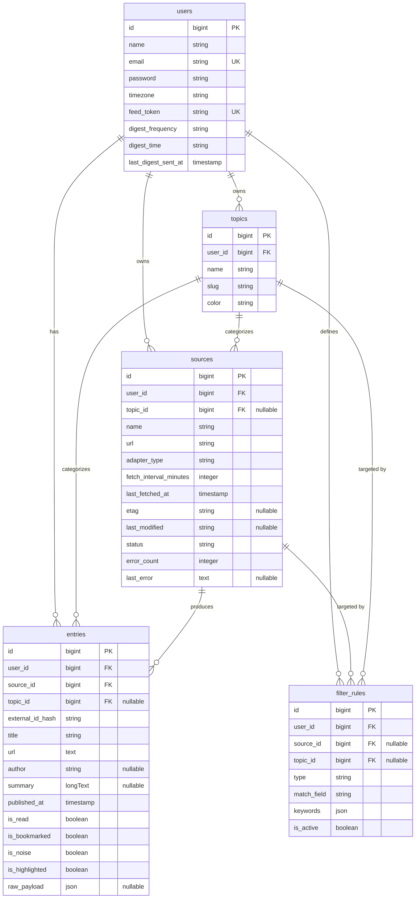

# Архітектура та пофазний план розробки Signal-to-Noise Hub

> [English version](../en/ARCHITECTURE_AND_PLAN.md) · [Посібник по проєкту](README.md) · [Покроковий підручник та історія створення](TUTORIAL_AND_BUILD_HISTORY.md)

Цей документ фіксує початкову концепцію проєкту, ключові архітектурні рішення (ADR), схему бази даних та пофазний план реалізації з 6 етапів.

---

## 1. Принцип «Мінімум зовнішніх залежностей»

Уся серверна механіка побудована на вбудованих інструментах **Laravel 13** та стандартних розширеннях PHP — без Redis, Meilisearch, Docker-мікросервісів або важких сторонніх парсерів:

| Завдання | Реалізація у проєкті |
| :--- | :--- |
| **База даних, черги та кеш** | `SQLite` (з режимом WAL) + вбудовані драйвери `QUEUE_CONNECTION=database` і `CACHE_STORE=database` |
| **Збір даних (Адаптери)** | `Illuminate\Support\Facades\Http` + нативний PHP `SimpleXMLElement` (RSS 2.0, Atom, GitHub Releases, Reddit) + `json_decode` (JSON Feed) |
| **Санітизація HTML** | Нативний PHP `DOMDocument` (`App\Services\HtmlSanitizer`) |
| **Rate Limiting та кеш HTTP** | `RateLimiter::attempt()` за доменом + заголовки `If-None-Match` (`ETag`) та `If-Modified-Since` (`Last-Modified`) |
| **Повнотекстовий пошук** | `laravel/scout` із драйвером `SCOUT_DRIVER=database` |
| **Приватний RSS** | `PrivateFeedController` + Blade XML-шаблон (`Content-Type: application/rss+xml`) + `Cache::remember` |
| **Інтерфейс** | Blade-компоненти + Livewire 4 + Alpine.js 3 + Tailwind CSS |

---

## 2. Ключові архітектурні рішення (ADR)

### ADR-01: Конкурентність SQLite під час роботи воркерів черг
* **Проблема:** За `QUEUE_CONNECTION=database` одночасний запис із вебінтерфейсу та фонового воркера може спричиняти помилку `database is locked`.
* **Рішення:** У `config/database.php` для підключення `sqlite` увімкнено `'journal_mode' => 'wal'` і `'busy_timeout' => 5000`. Читання не блокується під час запису, а процеси запису очікують звільнення блокування до 5 секунд.

### ADR-02: Дедуплікація записів зі складеним ключем
* **Проблема:** У деяких RSS-стрічках тег `<guid>` відсутній або змінюється при редагуванні допису.
* **Рішення:** Для кожного запису обчислюється відбиток `external_id_hash = hash('sha256', $source->id . ':' . $externalId)`, де `$externalId` обирається з резервуванням: `guid ?: link ?: title`. У таблиці `entries` задано унікальний складений індекс `UNIQUE(user_id, external_id_hash)`.

### ADR-03: Умовні HTTP-запити (`ETag` + `Last-Modified`) та `User-Agent`
* **Проблема:** GitHub і Reddit блокують запити без явного `User-Agent` (403/429), а часте опитування без кешу витрачає ліміти та трафік.
* **Рішення:** У таблиці `sources` зберігаються обидва заголовки: `etag` і `last_modified`. Адаптери передають `User-Agent`, `If-None-Match` та `If-Modified-Since`. За відповіді `304 Not Modified` завдання одразу оновлює `last_fetched_at` без розбору XML/JSON.

### ADR-04: Чіткий порядок роботи рушія правил (`Include → Exclude → Highlight`)
* **Рішення:**
  1. Якщо для поточної області дії (глобальної, джерела або теми) є хоча б одне активне `include`-правило, запис залишається сигналом лише за збігу бодай з одним `include`-словом; інакше `is_noise = true`.
  2. Далі перевіряються `exclude`-правила: перший збіг встановлює `is_noise = true`.
  3. Лише якщо запис не позначений як шум (`is_noise === false`), перевіряються `highlight`-правила і за збігу встановлюється `is_highlighted = true`.

---

## 3. Архітектура бази даних

---

## 4. Пофазний план реалізації та розподіл ролей

Проєкт виконувався у форматі парної розробки: **Розробник (бекенд-ядро та архітектура Laravel)** + **Antigravity (UI-верстка, санітизація HTML, фабрики/сідери та автоматизовані тести)**.

* **Фаза 1. Фундамент, схема БД і CRUD джерел:** розгортання Laravel 13 + Livewire 4, SQLite WAL, 5 таблиць і моделі Eloquent, Form Requests, `TopicManager`, `SourceManager`, автентифікація, фабрики та сідер.
* **Фаза 2. Архітектура адаптерів і ручний збір даних:** DTO `EntryData`, `SourceAdapterInterface`, `AdapterFactory`, `RssAtomAdapter`, `JsonFeedAdapter`, `EntryIngestionService`, команда `sources:fetch`, `HtmlSanitizer` і Unit-тести на фікстурах.
* **Фаза 3. Черги, планувальник і Rate Limiting:** `FetchSourceJob` (`$tries = 3`, `$backoff`), `RateLimiter` за хостом, `ETag`/`Last-Modified`/`304`, щохвилинний `Schedule`, кнопка `Fetch Now` в UI та Feature-тести черг.
* **Фаза 4. Рушій фільтрації шуму (`NoiseFilterService`):** конвеєр правил у `EntryIngestionService`, `SaveFilterRuleRequest`, `FilterRuleManager` із попереднім переглядом правил, UI з чипсами на Alpine.js і тести комбінацій правил.
* **Фаза 5. Вебстрічка хабу та повнотекстовий пошук:** `laravel/scout` (`database`), `FeedHub` із вкладками, фільтрами та діями, бічна шторка читання, гарячі клавіші на Alpine.js і тести пошуку.
* **Фаза 6. Вихідні канали (Приватний RSS і Email-дайджест):** `PrivateFeedController`, XML-шаблон RSS 2.0, `DailyDigestMail`, `SendDigestMailJob`, команда `digests:send` з урахуванням часового поясу, `ProfileSettings` і Feature-тести з `Mail::fake()` та `Carbon::setTestNow()`.
